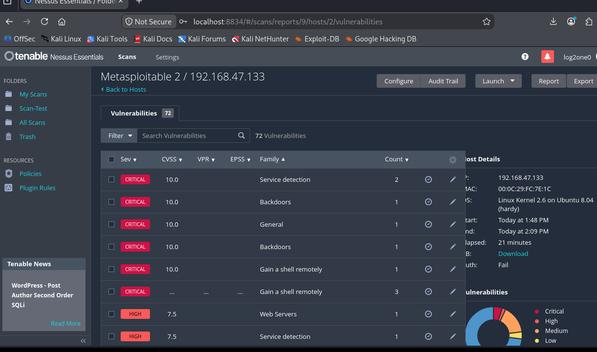
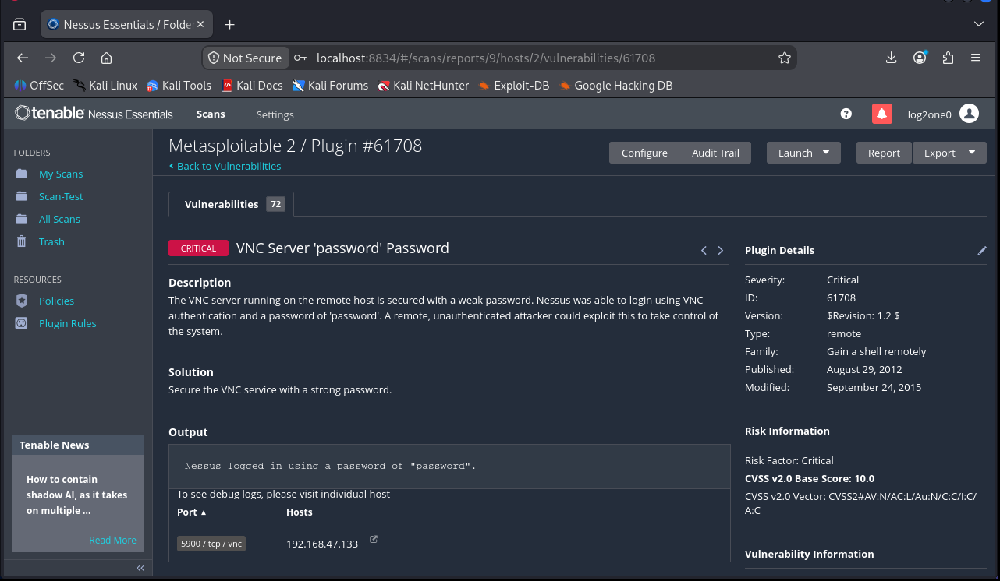

# Job 04 — Analyse du scan de vulnérabilités

**Projet :** Découverte et Exploitation de Vulnérabilités
**Cible :** Metasploitable 2 (`192.168.47.133`)
**Outil :** Nessus Essentials — Basic Network Scan (non authentifié)

---

## 1. Méthodologie du scan

| Paramètre | Valeur |
|---|---|
| **Outil** | Nessus Essentials (scanner local) |
| **Modèle de scan** | Basic Network Scan |
| **Cible** | `192.168.47.133` (Metasploitable 2) |
| **Type d'authentification** | **Non authentifié** (*unauthenticated*) |
| **Base de criticité** | CVSS v2.0 |
| **Durée** | 22 minutes |
| **Statut** | Terminé (*Completed*) |

> **Choix du scan non authentifié :** Nessus a analysé la cible « de l'extérieur », sans identifiants, comme le ferait un attaquant réel ne disposant d'aucun accès. C'est la démarche adaptée à ce projet. Un scan *credentialed* (authentifié) donnerait des résultats plus détaillés — notamment les correctifs manquants au niveau système — mais sort du cadre de l'exercice.

---

## 2. Résultats globaux

Nessus a identifié **72 vulnérabilités uniques** sur l'hôte, réparties ainsi :

| Criticité | Nombre | Score CVSS |
|---|---|---|
| **Critique** | 9 | 9.0 – 10.0 |
| **Élevé** (High) | 29 | 7.0 – 8.9 |
| **Moyen** (Medium) | 8 | 4.0 – 6.9 |
| **Info** | 135 | — (information, pas une faille) |

Ce profil — une machine présentant **9 vulnérabilités critiques** et des dizaines de failles élevées sur un seul hôte — est caractéristique de Metasploitable 2, une distribution **volontairement vulnérable** conçue pour l'apprentissage.

*Figure 1 — Onglet « Vulnerabilities » de Nessus : 72 vulnérabilités, dont 9 critiques (CVSS 10.0). Détails de l'hôte : Metasploitable 2 (Linux 2.6 / Ubuntu 8.04), scan de 21 minutes, « Auth: Fail » (non authentifié).*

---

## 3. Vulnérabilités critiques représentatives

Exemples de failles critiques identifiées par Nessus (CVSS 10.0) :

| Vulnérabilité | CVE | Service / Port | Famille Nessus |
|---|---|---|---|
| **UnrealIRCd Backdoor** | CVE-2010-2075 | IRC / 6667 | Backdoors |
| **Debian OpenSSH/OpenSSL RNG Weakness** | CVE-2008-0166 | SSH / 22 | Gain a shell remotely |
| **VNC Server 'password' Password** | — | VNC / 5900 | Gain a shell remotely |
| **Samba (SMB/CIFS)** | — | SMB / 139, 445 | Gain a shell remotely |

> **Détail notable — UnrealIRCd :** la sortie (*Output*) de Nessus indique que le service IRC tourne en tant que **`uid=0(root)`**. Une exploitation de cette porte dérobée donne donc un accès **directement root**, sans étape d'élévation de privilèges.

Exemple de fiche détaillée Nessus pour une vulnérabilité critique :

*Figure 2 — Fiche détaillée Nessus : « VNC Server 'password' Password » (CVSS 10.0, port 5900). Nessus a réussi à se connecter au service VNC avec le mot de passe « password » — exemple d'authentification faible critique.*

> *La liste complète des 9 vulnérabilités critiques est visible dans l'onglet « Vulnerabilities » de Nessus (Figure 1), en filtrant sur la sévérité « Critical ».*

---

## 4. Classification par type de vulnérabilité

> *C'est le cœur du Job 04 : « décrire le type de vulnérabilités trouvées ».*

Les failles détectées se répartissent en plusieurs grandes catégories :

### Portes dérobées (*Backdoors*)
Des services contenant un code malveillant intégré, permettant l'exécution de commandes à distance.
- *Exemple :* UnrealIRCd (port 6667) — exécution de code en tant que root.

### Exécution de code / prise de contrôle à distance (*Remote Code Execution*)
Failles permettant à un attaquant d'exécuter ses propres commandes ou d'obtenir un shell sur la machine, sans authentification.
- *Famille Nessus :* « Gain a shell remotely ».

### Logiciels et services obsolètes
Des services tournant dans des versions anciennes et non corrigées, exposées à des CVE connues (serveur web Apache, Samba, OpenSSH, serveurs FTP, bases de données…).

### Faiblesses cryptographiques
Génération de clés et de certificats prévisibles, protocoles de chiffrement faibles (ex. faille du générateur de nombres aléatoires OpenSSL sous Debian).

### Authentification faible ou par défaut
Services accessibles avec des identifiants faibles, par défaut, ou sans authentification (bases de données, services réseau, protocoles en clair comme Telnet, service VNC protégé par le mot de passe « password »).

### Erreurs de configuration
Services inutiles exposés, droits trop permissifs, partages réseau mal protégés.

---

## 5. Vulnérabilité retenue pour l'exploitation (Job 05-06)

Parmi les 9 failles critiques, la vulnérabilité **UnrealIRCd Backdoor (CVE-2010-2075)** a été retenue pour la phase d'exploitation, pour trois raisons :

1. **Détectée et confirmée** par Nessus (criticité 10.0).
2. **Module d'exploitation disponible** et fiable dans Metasploit.
3. **Accès root direct** : le service tourne en `uid=0`, l'exploitation donne immédiatement les privilèges maximaux.

> Le sujet cite la « vulnérabilité SMB » à titre d'exemple ; l'exercice demande d'exploiter **une** vulnérabilité critique. UnrealIRCd répond pleinement à cette exigence et offre la chaîne la plus propre entre détection (Nessus) et exploitation (Metasploit).

---

## 6. Synthèse

- Le scan **non authentifié** de Metasploitable 2 a révélé **72 vulnérabilités**, dont **9 critiques**.
- Les failles couvrent tout le spectre : **portes dérobées, exécution de code à distance, services obsolètes, faiblesses cryptographiques, authentification faible et erreurs de configuration**.
- La machine est, comme attendu, **massivement vulnérable** — elle constitue un terrain d'entraînement idéal.
- La vulnérabilité **UnrealIRCd Backdoor** servira de base à la phase d'exploitation (Job 05-06).
